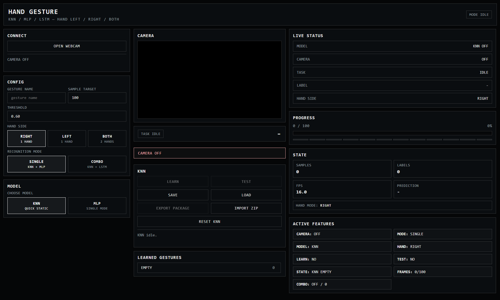

# Hand Gesture Learning

Ứng dụng web học và nhận diện cử chỉ tay: webcam chạy trên trình duyệt, **MediaPipe** và các mô hình **KNN / MLP / LSTM** chạy trên **Python server** (FastAPI + WebSocket).



*Ảnh minh họa: Connect, Config (tên cử chỉ, ngưỡng, tay trái/phải/cả hai, loại cử chỉ Static/Sequence), chọn model KNN/MLP/LSTM, vùng camera, danh sách cử chỉ đã học, Live status và Progress. Nút Record thu theo lượt: ở Sequence, một lượt (take) = một lần thực hiện cử chỉ; ô "Takes per run" và "Wait before each take" cho phép tự ghi liên tiếp nhiều lượt. Lớp NONE (Record NONE) là mẫu "không phải cử chỉ".*

---

## Tính năng chính

| Khu vực | Mô tả |
|--------|--------|
| **Connect** | Mở / tắt webcam; trạng thái kết nối tới server qua WebSocket. |
| **Config** | Tên cử chỉ, số mẫu mục tiêu (`target`), ngưỡng tin cậy (`threshold`), chọn **tay phải / tay trái / cả hai tay**, loại cử chỉ **Static** (tư thế tĩnh, KNN/MLP) hoặc **Sequence** (chuyển động theo thời gian, (KNN/LSTM ghi sequence thủ công, không dùng rule Pattern/Result và không còn ô Sequence target). |
| **Model** | Chọn **KNN** (nhanh, tĩnh), **MLP** (mạng nơ-ron scikit-learn), **LSTM** (chuỗi khung hình; TensorFlow nếu có, không thì fallback sklearn). Với **Combo**, ứng dụng ghi từng record theo kiểu thủ công giống LSTM capture: bấm Learn để ghi record đầu; sau khi tên đó đã có dữ liệu, nút sẽ đổi thành Add record để ghi thêm sequence mới. Khi đổi sang một tên mới chưa có trong danh sách, nút sẽ tự trở lại Learn. |
| **Học / Test** | Thu mẫu landmark theo nhãn, train model, bật chế độ test để xem dự đoán realtime. |
| **Lưu / Tải** | **Save local** / **Load local**: ghi đọc state JSON trong `backend/storage/`. **Export package** / **Import file**: gói `.zip` hoặc JSON trong `backend/exports/`. |
| **Reset** | Xóa dữ liệu theo từng mode (KNN / MLP / LSTM). |
| **Live status** | Model, camera, task, nhãn đang học, dự đoán, chế độ tay, FPS, progress. |

---

## Kiến trúc và luồng dữ liệu

```text
Trình duyệt (webcam + UI)
    │  WebSocket /ws  (frame base64 + lệnh JSON)
    ▼
FastAPI (backend/web.py)
    │  AppState.process_frame / handle_command
    ▼
MediaPipe Hand Landmarks → features (vector) → KNN | MLP | LSTM
    │
    ▼
Snapshot JSON (UI đồng bộ trạng thái, overlay vẽ tay)
```

- **Web** chỉ vẽ giao diện và gửi khung hình; không chạy MediaPipe trong JS cho pipeline chính.
- **Server** gom state một chỗ (`AppState`), trả về overlay và kết quả nhận diện sau mỗi frame hoặc lệnh.
- Ở **Combo (KNN/LSTM)**, mỗi lần bấm Learn hoặc Add record sẽ ghi đúng một sequence hoàn chỉnh; số lần ghi do bạn chủ động bấm thêm bao nhiêu lần cũng được.

---

## Cấu trúc thư mục dự án

```text
hand_gesture_learning/
├── README.md                      # Tài liệu dự án (file này)
├── run.py                         # Điểm vào: khởi chạy uvicorn
├── requirements.txt               # -r backend/requirements.txt
├── demo_hand_gesture_learning.png # Ảnh demo giao diện
│
├── frontend/
│   └── index.html                 # Giao diện đơn trang + logic WebSocket client
│
└── backend/
    ├── __init__.py                # Gói Python backend
    ├── requirements.txt           # Danh sách thư viện pip
    ├── web.py                     # FastAPI: `/`, `/api/status`, `/ws`, static `/exports`
    ├── app_state.py               # Trạng thái ứng dụng: camera, học, train, predict, import/export
    ├── paths.py                   # Đường dẫn ROOT, frontend, storage, exports; tạo thư mục nếu thiếu
    ├── features.py                # Trích vector đặc trưng từ landmark (góc, tọa độ chuẩn hóa)
    ├── hand_tracking.py           # MediaPipe Hand (Tasks hoặc adapter tương thích), tải model nếu cần
    ├── deps.py                    # Import tùy chọn: mediapipe, tensorflow (an toàn khi thiếu gói)
    ├── storage/                   # File state đã lưu (vd. knn-state.json) — tạo khi chạy
    └── exports/                   # Gói export .zip — tạo khi chạy
```

---

## Mô tả từng file quan trọng

| File | Vai trò |
|------|---------|
| **`run.py`** | Import `app` từ `backend.web`, hàm `main()` gọi `uvicorn.run('backend.web:app', host='127.0.0.1', port=8000)`. |
| **`backend/web.py`** | Định nghĩa `FastAPI`, phục vụ `index.html` tại `/`, API tóm tắt `/api/status`, WebSocket `/ws` nhận `frame` và các lệnh điều khiển. |
| **`backend/app_state.py`** | Lớp `AppState`: cấu hình (`hand_mode`, `threshold`, …), buffer mẫu theo mode, KNN fit tức thì, train MLP/LSTM, serialize/deserialize state, xử lý frame ảnh và trả overlay. |
| **`backend/features.py`** | `extract_features`: vector cố định chiều từ một tay; `combine_vec` ghép hai tay khi chế độ **Both**. |
| **`backend/hand_tracking.py`** | Khởi tạo landmarker, chuyển kết quả sang dạng legacy để `app_state` dùng chung. |
| **`backend/paths.py`** | `STATIC_INDEX` → `frontend/index.html`; `STORAGE_DIR`, `EXPORT_DIR` dưới `backend/`. |
| **`backend/deps.py`** | Cờ `MEDIAPIPE_TASKS`, import `mp` / `tf` / layer Keras — `None` nếu không cài được. |
| **`frontend/index.html`** | Toàn bộ UI: theme, nút, WebSocket client, đồng bộ snapshot, vẽ video/overlay theo dữ liệu server. |

---

## API tóm tắt (HTTP / WebSocket)

- **`GET /`** — Trả về HTML giao diện (đọc từ `frontend/index.html`).
- **`GET /api/status`** — JSON snapshot trạng thái (cùng kiểu dữ liệu gần giống snapshot WebSocket).
- **`GET /exports/...`** — Tải file tĩnh trong thư mục export (nếu có).
- **`WebSocket /ws`** — Sau khi accept, server gửi `{ type: 'snapshot', snapshot: ... }`. Client gửi JSON:
  - **`type: 'frame'`** — Khung ảnh (data URL) + `config` tùy chọn; server trả `frame_result` (overlay, prediction, …).
  - Các lệnh khác (vd. `config`, `start_camera`, `learn`, `train`, `save`, `load`, …) qua `handle_command`; server trả `command_result`.

Chi tiết payload nằm trong `app_state.py` (`handle_command`, `update_config`, …) và phần gửi tin trong `frontend/index.html`.

---

## Cài đặt và chạy

**Yêu cầu:** Python 3.10+ (khuyến nghị), môi trường ảo nếu cần.

Từ thư mục chứa `run.py` và `backend/`:

```bash
pip install -r requirements.txt
python run.py
```

Hoặc gọi trực tiếp uvicorn:

```bash
uvicorn backend.web:app --host 127.0.0.1 --port 8000
```

Mở trình duyệt: **http://127.0.0.1:8000**

### Gói phụ thuộc (`backend/requirements.txt`)

Gồm FastAPI, Uvicorn, NumPy, OpenCV (headless), scikit-learn, joblib, MediaPipe, TensorFlow. TensorFlow dùng cho LSTM đầy đủ; nếu không cài được, code có nhánh fallback (xem `deps.py` và `app_state.py`).

---

## Dữ liệu lưu trên đĩa

- **`backend/storage/`** — State JSON theo mode (ví dụ `knn-state.json`): mẫu, nhãn, metadata train.
- **`backend/exports/`** — Gói zip xuất từ nút Export trên UI.

Thư mục được tạo tự động khi server chạy (`paths.py`).

---

## Ghi chú / xử lý sự cố

- **Chưa cài MediaPipe:** giao diện vẫn mở; thông báo lỗi khi xử lý frame (không có landmark).
- **Không có TensorFlow:** LSTM có thể dùng MLP sklearn trên chuỗi đã là phẳng (hành vi fallback trong code).
- **Combo (KNN/LSTM)** không còn dùng rule học chuỗi; mỗi lần bấm Learn / Add record sẽ ghi một sample temporal giống luồng capture của LSTM.
- Nếu bạn đã từng train KNN theo kiểu single-frame, dữ liệu đó sẽ không bị đem sang combo chuỗi; combo chỉ dùng các sample có đúng độ dài chuỗi để tránh lẫn mẫu tĩnh với mẫu chuỗi.
- **Chạy sai thư mục:** Phải chạy `python run.py` từ thư mục gói `hand_gesture_learning` để import `backend` đúng.
- **Chế độ tay / chiều vector:** Mẫu thu ở chế độ một tay (71 đặc trưng) và cả hai tay (142) là không gian khác nhau; không nên trộn trong cùng một bộ train nếu muốn kết quả ổn định — nên thu và train nhất quán theo một `hand mode` cho từng bộ dữ liệu.

---

## Giấy phép và đóng góp

Dự án bundle học tập / demo. Tuỳ chỉnh và mở rộng theo nhu cầu của bạn.

## Hướng dẫn thu thập và dùng model

**Loại cử chỉ**
- **Static**: tư thế tĩnh (KNN/MLP). Mỗi khung hình là một mẫu; giữ nguyên tư thế cho tới đủ "Frames to record".
- **Sequence**: cử chỉ có chuyển động theo thời gian (KNN/LSTM, ví dụ búng tay). Một lượt (take) = một lần thực hiện cử chỉ trong "Frames / take" khung (mặc định 30, khoảng 1 giây).

**Thu mẫu (Record)**
- Sequence: bấm **Record** một lần; app đếm ngược "Wait (s)" rồi ghi một lượt, sau đó tự ghi tiếp cho tới đủ "Takes per run". **Stop** để huỷ.
- Mất tay giữa chừng thì lượt đang ghi được làm lại từ đầu.
- Số lượt gợi ý cho mỗi cử chỉ: 10–15 để thử, 30–50 để dùng, 80–100 chia nhiều lượt (đổi khoảng cách, ánh sáng).

**Lớp NONE (không phải cử chỉ)**
- Bấm **Record NONE** để thu tay nghỉ và các cử động khác. Cần ít nhất 2 nhãn mới train được MLP/LSTM; nếu thiếu NONE, model sẽ gọi mọi thứ là cử chỉ của bạn.
- Static: một lần thu đủ "Frames to record". Sequence: thu liên tục bằng cửa sổ trượt chồng 50% cho tới đủ "NONE windows".
- Nên thu NONE bằng hoặc nhiều hơn số lượt của cử chỉ, gồm cả lúc đưa tay lên gần giống cử chỉ nhưng không làm.
- Kết quả `none` khi test không được tính là cử chỉ nhận ra.

**Điều kiện thu (Advanced)**
- **Capture width** (px) và **Max FPS** quyết định độ nhiễu của landmark; train và chạy thật phải dùng cùng giá trị. Gói export ghi lại `captureProfile` và nạp gói sẽ khôi phục giá trị này.
- Model chạy trên landmark đã chuẩn hoá chứ không phải pixel, nên không có "model ở px nào".
- **Threshold**: dưới ngưỡng này kết quả là `unknown`.

**Evaluate**
- Lấy 80% mẫu thu trước của mỗi nhãn để train một model tạm, 20% thu sau để kiểm tra; báo số bắt đúng, bỏ sót, báo nhầm theo từng nhãn. Không thay thế model chính: vẫn cần bấm **Train**.
- Chia theo thời gian để tránh số đẹp giả do các khung liền kề giống nhau. Mẫu kiểm tra ít (dưới 10 mỗi nhãn) thì 100% không đáng tin; thu phần kiểm tra ở lượt riêng.

**Export**
- Gói `.zip` gồm model gốc, dữ liệu, `*-manifest.json`, `*-portable.json` (trọng số dạng số) và `gesture_runtime.py` + `features.py` (chạy bằng NumPy, không cần sklearn/TensorFlow).
